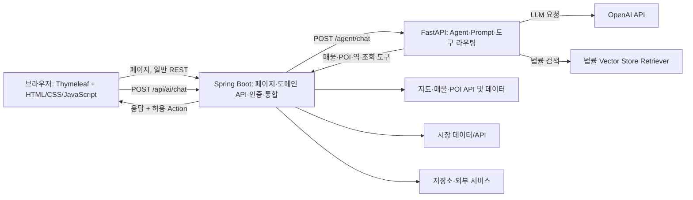

# 집찾GO 시스템 아키텍처 설계서

## 1. 논리 아키텍처

## 2. 책임 분리

| 구성 요소 | 주요 책임 | 코드 근거 |
| --- | --- | --- |
| Browser / Frontend | 지도·페이지 렌더링, App State 구성, AI 채팅, 정의된 Action 실행 | `templates/property/map.html`, `static/js/map.js`, `static/js/ai-chat.js` |
| Spring Boot | 웹 페이지, 인증·도메인 API, 지도·매물 API, FastAPI 호출 | `src/main/java/com/onrender/zipchatgo/**` |
| FastAPI | 대화 검증, Provider·Prompt 호출, Tool 선택/실행, RAG 및 응답 구성 | `ai-server/app/main.py`, `providers/`, `tools/`, `retrievers/` |
| OpenAI | 설정된 모델을 통한 응답 및 Tool Calling | `ai-server/app/providers/openai_provider.py` |
| 법률 Retriever | 설정된 Vector Store 기반 법률 검색 | `ai-server/app/retrievers/` |
| 지도/시장 데이터원 | 매물·POI·거래/시장 데이터 제공 | Spring 지도·시장 모듈 및 외부 API 설정 |

## 3. 대표 API 경계

| 호출자 → 제공자 | 경로 | 용도 |
| --- | --- | --- |
| Frontend → Spring | `POST /api/ai/chat` | AI 대화 요청의 외부 진입점 |
| Spring → FastAPI | `POST /agent/chat` | Agent 실행 |
| Spring → FastAPI | `POST /agent/test` | 연결 확인 |
| Frontend/AI Tool → Spring | `GET /api/map/properties/search` | 지도 매물 검색 |
| Frontend/AI Tool → Spring | `GET /api/map/properties/by-ids` | 매물 ID 조회 |
| Frontend/AI Tool → Spring | `GET /api/map/transit/stations/search` | 역 검색 |
| Frontend/AI Tool → Spring | `GET /api/map/pois/search` | POI 검색 |
| FastAPI → 상태 확인 | `GET /health` | AI 서버 상태 확인 |

## 4. 데이터 및 요청 경계

- AI 요청 모델은 `ChatRequest`이며 메시지, 선택 App State, 대화 이력, 최근 문맥을 포함한다.
- App State에는 지도 중심·bounds·선택 지역·매물·관심매물 ID·필터 등 제한된 필드만 둔다.
- UI 응답은 자연어 `message`, 허용된 `actions`, `recent_context` 등 명시된 응답 계약을 따른다.
- FastAPI 내부 API Key는 설정된 경우 `X-Internal-Api-Key` 헤더로 검증한다.
- 도메인 DB 접근은 Spring 서비스 경계를 거치도록 설계한다.

## 5. 배포 및 실행

로컬 기준 개발 계획의 포트는 Spring Boot `8080`, FastAPI `8000`입니다. 일반 웹 요청은 Spring Boot로 들어오고, AI 요청은 Spring Boot가 FastAPI를 호출합니다. 배포에서는 Render 서비스 분리 설정이 저장소에 포함되어 있으나 실제 Secret·인스턴스·도메인 설정은 환경별로 별도 관리합니다.

필요 환경변수는 `.env.example`, `ai-server` 설정과 배포 문서를 기준으로 설정합니다. 비밀값은 GitHub 문서나 저장소에 기록하지 않습니다.

## 6. 품질·보안 경계

- 브라우저는 AI가 만든 임의 코드를 실행하지 않는다.
- Action 종류 및 입력은 Python 스키마와 Frontend 처리 코드의 허용 목록으로 제한한다.
- 요청 크기와 목록 길이는 Pydantic 필드 제약으로 제한한다.
- FastAPI 내부 호출은 선택적 내부 Key 검증을 지원한다.
- 법률 검색과 시장 데이터는 구성 여부·기준 시점·출처에 따라 결과 한계가 있다.

