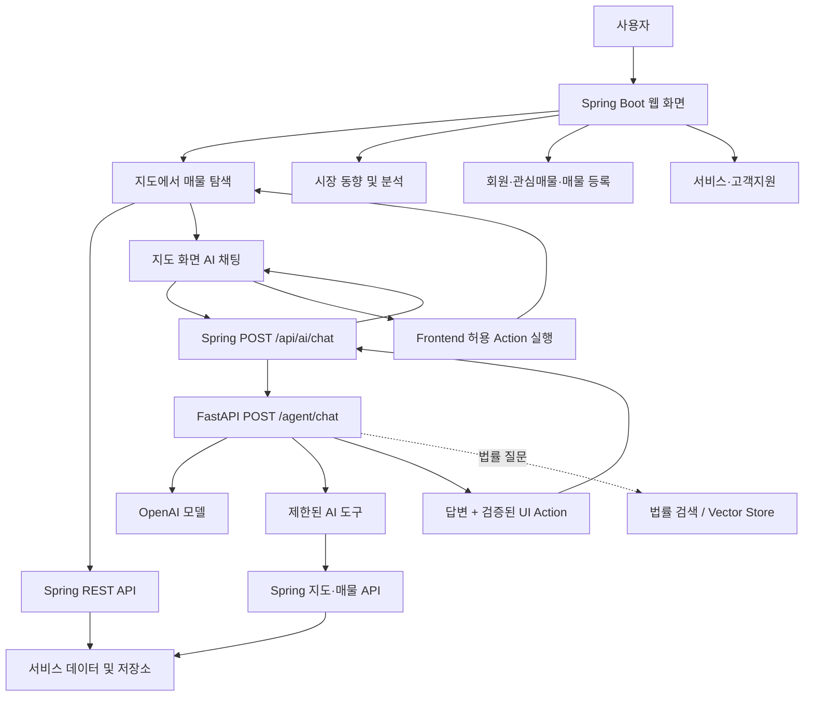
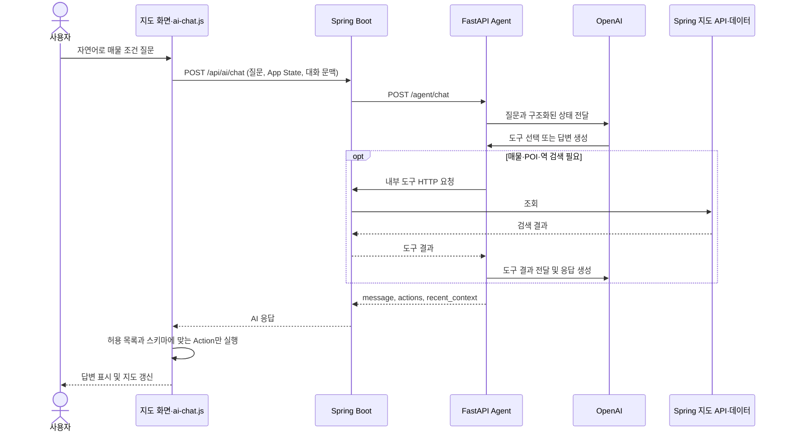

# 집찾GO 프로젝트 플로 차트

이 플로 차트는 현재 구현을 기준으로 일반 웹 요청과 AI 대화 요청을 분리해 보여줍니다. 점선 경로는 개발 계획에 포함되어 있지만 현재 구현이 확인되지 않은 기능입니다.

## 서비스 전체 흐름



## AI 매물 탐색 시나리오



## 사용자 여정

```text
홈 → 지도 열기 → 위치·조건 검색 → 매물/주변 POI 확인 → 상세 확인
                                         ├→ 관심매물 저장
                                         ├→ AI에게 질문 → 지도 Action 반영
                                         └→ 시장 동향·분석 화면으로 이동
```

관심매물 데이터 영속성, 분석 페이지를 조작하는 AI Tool, 페이지 간 대화 문맥 공유 등은 별도 구현 확인이 필요한 범위입니다. 이를 현재 완성된 흐름으로 간주하지 않습니다.

