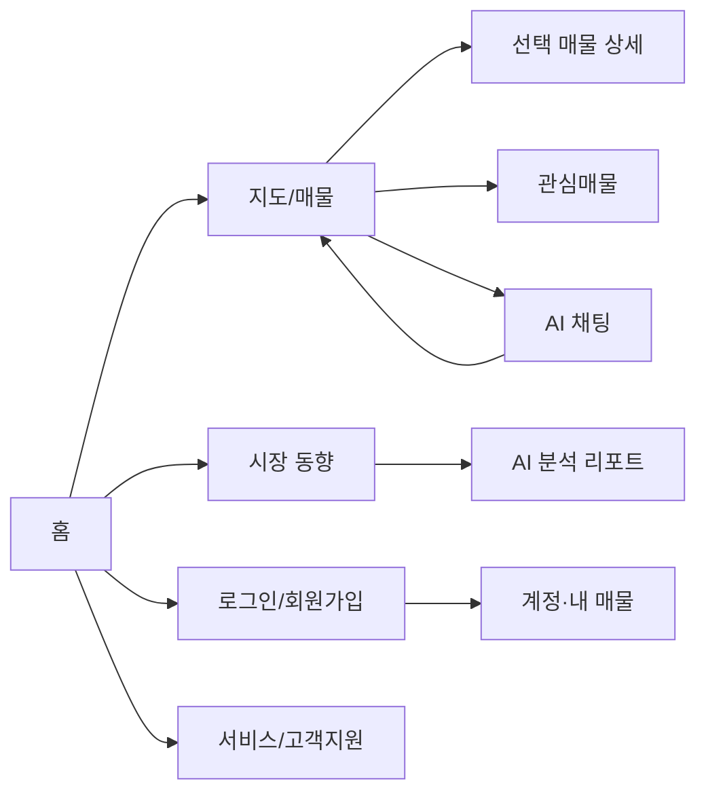

# 집찾GO 화면 설계서

이 문서는 저장소의 Thymeleaf 템플릿과 라우트를 기준으로 현재 화면의 목적과 주요 영역을 요약합니다. 픽셀 단위 시안이 아닌 정보 구조 및 화면 간 이동 설계입니다.

## 1. 주요 화면 목록

| 화면 | 경로 | 주요 사용자 작업 | 구현 위치 |
| --- | --- | --- | --- |
| 홈 | `/` | 서비스 진입 및 주요 기능 이동 | `templates/index.html` |
| 지도·매물 탐색 | `/property/map` | 지역/단지 검색, 매물·POI 확인, AI 질문 | `templates/property/map.html` |
| 매물 등록 | `/properties/register` | 등록 정보와 사진 입력 | `templates/property/register.html` |
| 관심매물 | `/favorites` | 저장 매물 목록 확인 | `templates/member` 및 관련 스크립트 |
| 내 매물 | `/my/properties` | 등록 매물과 상세 확인 | `templates/member/my-properties.html` |
| 로그인·회원가입 | `/member/login`, `/member/signup` | 인증 및 계정 진입 | `templates/member/auth.html` 등 |
| 시장 동향·상세 분석 | `/market/**` | 거래·지역 지표별 탐색 | `templates/market/*.html` |
| AI 분석 리포트 | `/market/ai-report` | 지역·주택 조건별 시연 분석 확인 | `templates/market/ai-report.html` |
| 서비스·팀 소개 | `/about/service`, `/about/team` | 서비스 설명과 프로젝트 소개 | `templates/support/*.html` |
| 고객지원 | `/support/**` | 가이드, 문의, 공지 등 확인 | `templates/support/*.html` |

정확한 라우트와 별칭은 `PageController`, `MapPageController`, `FavoritePageController`를 기준으로 합니다.

## 2. 지도 페이지 정보 구조

```text
┌──────────────────────────────────────────────────────┐
│ 공통 헤더: 로고 · 로그인/가입 · 고객센터 · 관심매물 │
├─────────────────┬────────────────────────────────────┤
│ 검색 입력/버튼  │                                    │
│ 검색 조건/결과  │             네이버 지도             │
│ 매물 카드 목록  │       매물 마커 · POI · 경계         │
│                 │                                    │
├─────────────────┴────────────────────────────────────┤
│ AI 채팅 패널: 질문 입력 → 답변/매물 링크 → 지도 Action│
└──────────────────────────────────────────────────────┘
```

주요 상호작용은 검색어 입력, 결과 선택, 지도 이동, 마커/POI 확인, 거리·지역 정보 확인, AI 질문 및 Action 반영입니다. 세부 도구의 표시 여부는 화면 상태와 지도 설정에 따라 달라질 수 있습니다.

## 3. AI 채팅 상태

| 상태 | 화면 피드백 |
| --- | --- |
| 입력 대기 | 질문 입력 및 전송 가능 |
| 요청 중 | 입력/전송 상태 변경 및 대기 표시 |
| 응답 성공 | 답변과 관련 매물 링크 표시 |
| Action 실행 | 응답 Action에 따라 지도 또는 매물 UI 반영 |
| 오류 | 오류 안내 후 재요청 가능 |

요청 데이터는 전체 DOM이 아닌 구조화된 App State와 제한된 대화 문맥입니다. AI가 반환한 Action은 브라우저가 허용된 타입인지 확인한 뒤 실행합니다.

## 4. 시장 분석 화면

시장 동향 화면은 공통 내비게이션 아래 분석 조건과 차트·지표를 배치합니다. AI 리포트 화면에는 지역, 주택 유형, 면적, 전망 기간 선택, 분석 실행, 시장 온도·전망·거래 신호·신뢰도, 요인·전략·위험 정보가 있습니다. 페이지 자체에 일부 지표는 시연값이라는 고지가 있으므로 결과를 실거래 원천 데이터와 구분합니다.

## 5. 주요 화면 이동



## 6. 사용성 및 콘텐츠 기준

- 각 페이지는 공통 헤더와 명확한 페이지 제목을 제공한다.
- 지도 화면은 검색 결과와 지도 마커의 관계를 사용자가 알아볼 수 있어야 한다.
- 가격·거래·전망 수치는 기준 시점과 시연 데이터 여부를 알 수 있도록 표시한다.
- AI 설명은 데이터 조회 결과와 추론을 구분하고, 법률·투자 판단을 확정적으로 보장하지 않는다.
- 오류·빈 결과·로딩 상태는 실제 동작 흐름에 맞춰 안내한다.

